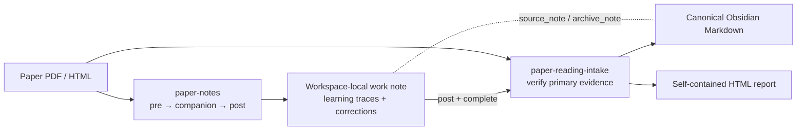

# Paper Reading Workflow

[](https://github.com/lelelelelelelelelelelelele/paper-reading-workflow/releases/latest)
[](LICENSE)

A paired Codex skill bundle for active academic-paper reading and durable Obsidian archival.

一套配对使用的论文阅读技能：先保留真实的精读、问答与订正过程，再生成干净、可展示、经主来源复核的 Obsidian 归档。

## 中文速览

- **`paper-notes` 是精读层**：负责读前地图、分章节伴读、自测、订正、个人判断和读后批判；始终维护 workspace-local Obsidian 中同一份有过程痕迹的工作笔记。
- **`paper-reading-intake` 是归档层**：检查同篇精读笔记，回到论文主来源复核证据，再输出一份 canonical Markdown 和一份自包含 HTML。
- 精读笔记不必放进 `20 Literature`。项目自己的 `notes/`、本地 reading log 或其他 workspace-local vault 都是合理位置；正式知识库只保存干净归档。
- 推荐顺序是 `paper-notes: pre → companion → post`，随后交给 `paper-reading-intake`。如果用户明确只想快速归档，intake 也支持标注清楚的 direct mode。
- 两个 skill 应一起安装。各自的 agent 说明位于 [`skills/paper-notes/SKILL.md`](skills/paper-notes/SKILL.md) 与 [`skills/paper-reading-intake/SKILL.md`](skills/paper-reading-intake/SKILL.md)。

## Why two skills?

Reading notes and formal archives serve different purposes. This bundle keeps them connected without mixing their contents.

| Skill | Role | Durable output |
|---|---|---|
| [`paper-notes`](skills/paper-notes/SKILL.md) | Active-reading layer: pre-read map, section self-tests, corrections, personal judgment, and post-read critique | One evolving Markdown work note in a workspace-local Obsidian vault |
| [`paper-reading-intake`](skills/paper-reading-intake/SKILL.md) | Archive layer: primary-source verification, paper-native figures, evidence boundaries, topic/index updates, and clean presentation | One canonical literature Markdown note plus one self-contained HTML report |



The work note does **not** have to live in `20 Literature`. It stays where active project reading happens. Only the clean archive pair belongs in the formal knowledge base.

## Typical usage

Use `paper-notes` while learning the paper:

```text
Use $paper-notes to make a pre-read map for this paper.
Use $paper-notes to accompany me section by section, ask self-test questions, and correct my answers.
Use $paper-notes to turn the completed reading into a critical post-read work note.
```

Use `paper-reading-intake` when the paper is ready for durable archival:

```text
Use $paper-reading-intake to verify this paper and archive it in Obsidian.
Reuse my matching paper-notes work note, then create one canonical Markdown note and one self-contained HTML report.
```

`paper-reading-intake` first looks for a matching `paper-notes` artifact. It resumes incomplete deep-reading work, consumes a completed post note, or uses an explicit direct-archive route when appropriate. It never fabricates a completed reading session.

## Output contract

The two skills exchange stable metadata including:

- `producer`
- `schema_version`
- `paper_id`
- `reading_stage`
- `status`
- `review_status`
- `source_note`
- `archive_note`

The archive layer rechecks claims, figures, captions, versions, and key numbers against primary sources. Raw blind answers and correction history remain in the work note; corrected conclusions and useful user insights may flow into the formal archive.

## Install

Install both sibling skills together. The intake workflow can operate in direct mode, but the full reading lifecycle depends on `paper-notes` being available.

### Clone once and link the skills

```bash
git clone https://github.com/lelelelelelelelelelelelele/paper-reading-workflow.git
```

For Codex, link or copy both directories under `skills/` into your Codex skill directory. On macOS or Linux:

```bash
mkdir -p "$HOME/.codex/skills"
ln -s "$(pwd)/paper-reading-workflow/skills/paper-notes" "$HOME/.codex/skills/paper-notes"
ln -s "$(pwd)/paper-reading-workflow/skills/paper-reading-intake" "$HOME/.codex/skills/paper-reading-intake"
```

On Windows PowerShell, from the directory containing the clone:

```powershell
New-Item -ItemType Directory -Force "$env:USERPROFILE\.codex\skills" | Out-Null
New-Item -ItemType Junction -Path "$env:USERPROFILE\.codex\skills\paper-notes" -Target "$(Get-Location)\paper-reading-workflow\skills\paper-notes"
New-Item -ItemType Junction -Path "$env:USERPROFILE\.codex\skills\paper-reading-intake" -Target "$(Get-Location)\paper-reading-workflow\skills\paper-reading-intake"
```

For another compatible agent, use its skill-discovery directory instead. The repository root is also plugin-shaped through [`.codex-plugin/plugin.json`](.codex-plugin/plugin.json), with both skills exposed from `skills/`.

To update a linked installation:

```bash
git -C paper-reading-workflow pull --ff-only
```

Start a new agent task after installation or update so the skill catalog is reloaded.

## Repository layout

```text
paper-reading-workflow/
├── .codex-plugin/plugin.json
├── skills/
│   ├── paper-notes/
│   │   ├── SKILL.md
│   │   ├── agents/openai.yaml
│   │   └── references/
│   └── paper-reading-intake/
│       ├── SKILL.md
│       ├── agents/openai.yaml
│       ├── references/
│       └── assets/
├── LICENSE
└── README.md
```

Detailed workflow rules live in the two `SKILL.md` files and their referenced resources. The skill directories intentionally do not contain separate READMEs, which would duplicate agent-facing instructions.

## Design guarantees

- One growing work note across pre-read, companion, and post-read stages.
- No silent claim that the user has read, answered, or reviewed something they have not.
- Stable paper identity before title-only fallback.
- Primary-source rechecking before formal archival.
- Exactly one editable archive Markdown and one matching self-contained HTML report.
- No hardcoded username, drive letter, vault root, or rclone remote.
- Add/update-only vault behavior by default; no note deletion or movement without explicit authorization.

## License

[MIT](LICENSE) © 2026 lele
